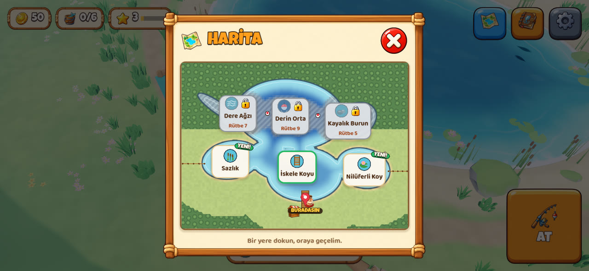
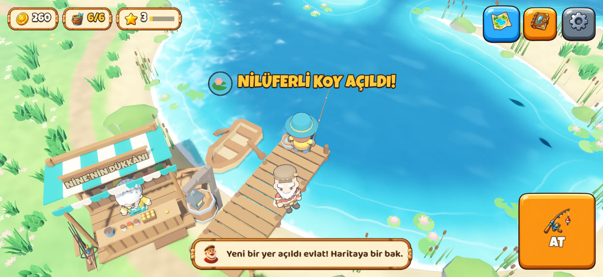
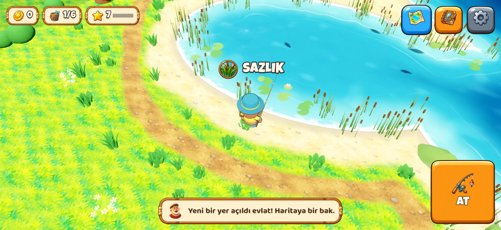
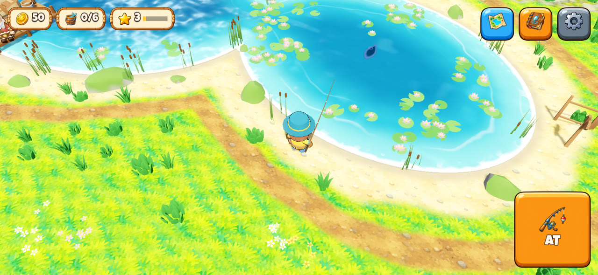
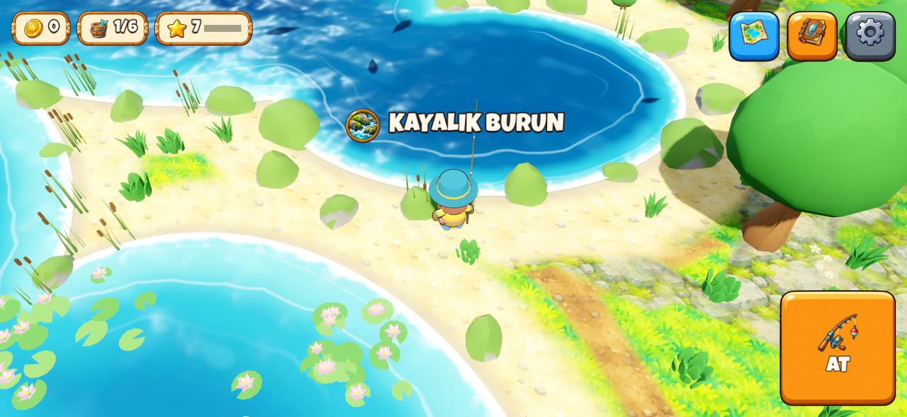
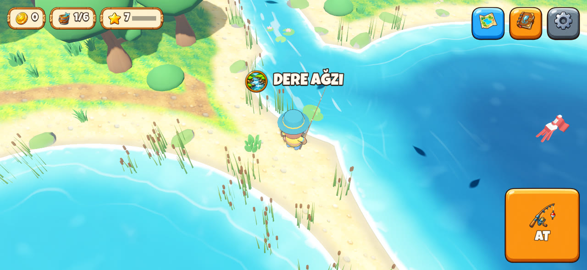
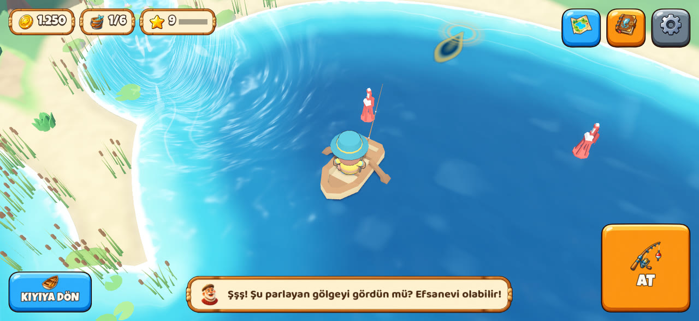
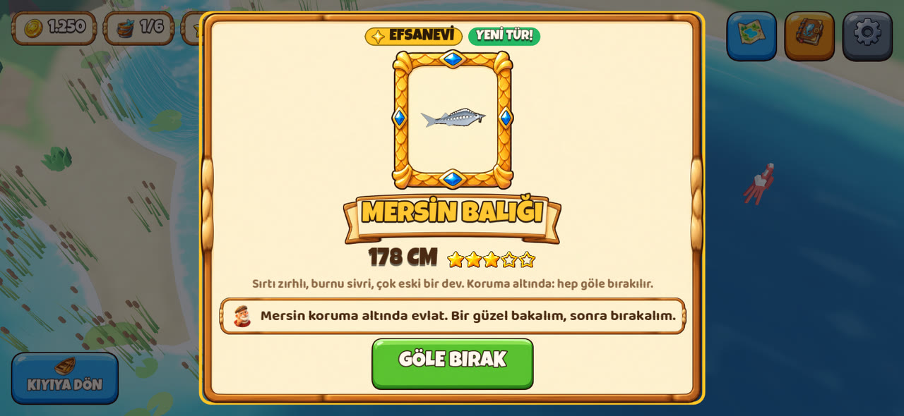
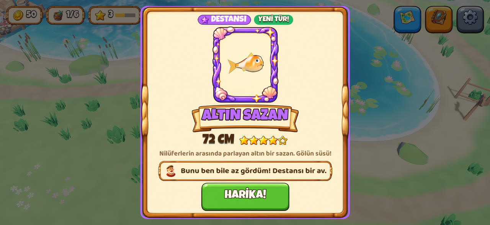
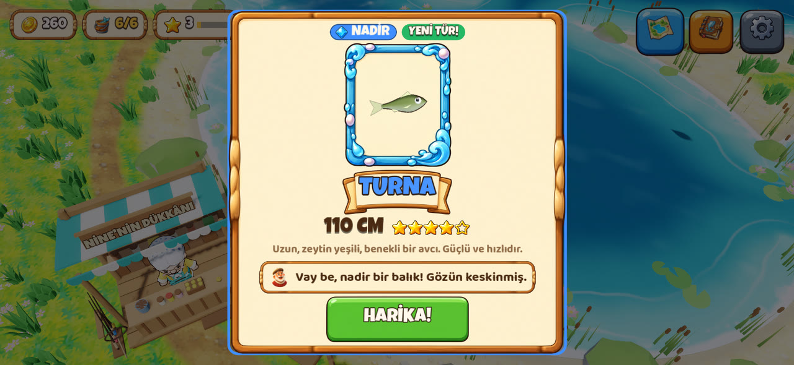

# Olta: Gölün Sırrı (EN: Lure Lake)

**"Kıyını süsle, havayı bekle: bu gece oltana ne takılacak?"** Her yaşa hitap eden, rahat bir 3D mobil balıkçılık oyunu (iOS + Android, yatay ekran). Kendi balıkçınla yazı Dede'nin göl köyünde geçiriyorsun. Suda balık gölgeleri dolaşıyor; gölgenin önüne atıyorsun, gölge yaklaşıp dürtüyor, ısırınca VUR ve çek. Ersin'in Kazı'dan sonraki oyunu; kodu Claude yazıyor.

> **Durum (Ekim 2026): v0.3.1 (H2 "Büyük Göl", Dalga 2 bitti; ara sürümde berrak görüntü ve "iri balık takım ister").** Göl büyüdü: altı bölge (iskele koyu, sazlık, nilüferli koy, kayalık burun, dere ağzı, derin orta), her birinin kendi balıkları ve süsleri. Bölgeler rütbeyle açılır; haritadan hızlı geçilir, koyların çevresinden kıyı yolu dolaşır. Nine'den alınan sandalla derin ortaya açılınır. 7 yeni tür (toplam 12): gümüş balığı, çapak, tatlısu kefali, kadife, sudak, altın sazan ve koruma altındaki mersin (kartıyla göle bırakılır). Su ve zemin yenilendi; zemin, bölge rozetleri ve parşömen harita Ersin'in görselleriyle (Parti 3). Telefonda hız ölçümü ayarlarda. Sırada Dalga 3: teknikler ([yol haritası](docs/yol-haritasi.md)).

| | |
|---|---|
|  |  |
|  |  |
|  |  |
|  |  |
|  |  |

## Nasıl oynanır

1. **At:** suya dokun. En iyisi bir gölgenin **önüne** atmak; üstüne atarsan balık korkup kaçar.
2. **Bekle:** gölge şamandırayı fark edip gelir, birkaç kez dürter (şamandıra hafifçe batar). Bu sırada dokunma.
3. **VUR:** şamandıra suya dalınca ekranın **her yerine** dokun.
4. **Çek:** parmağını basılı tut, balık gelsin. Balık çırpınınca ("!", titreşim, gıcırtı) **bırak**; gerilim kırmızıda kalırsa misina kopar.
5. Tutulan balık elde gösterilir; yeni tür, rekor ya da Nadir ve üstünde kart açılır.
6. **Kova ve dükkân:** tutulan balık kovaya girer. Nine'ye (iskelenin başındaki dükkân) dokun: kovayı sat, parayla yeni takım al. Bazı takımlar rütbe ister; rütbe balık tuttukça artar.
7. **İri balık takım ister:**
   - Sazan, turna, yayın, kadife, sudak, altın sazan ve mersin iri türlerdir. Boyları büyüdükçe daha çok çekerler.
   - Bambu olta 3 yıldıza kadarını taşır. 4★ için cam elyafı kamış ve naylon misina, 5★ için karbon kamış ve örgü misina gerekir; dükkân kartında "İri balık" yıldızları yazar.
   - Takımın taşımadığı balık takılınca "Çok iri!" çıkar; sakinken bile gerilim kırmızıya çıkar ve misina kopar. Ardından Dede neyi alman gerektiğini söyler.
   - Kolay modda kopmaz, yalnızca yavaş gelir.
8. **Nadirlik:** Sıradan ●, Güzel ▲, Nadir ◆, Destansı ★, Efsanevi ✦ (oyunda Ersin'in rozetleri; şekilleri renk körü oyuncu için de ayrılır). Nadir balığın gölgesi arada pırıldar, Destansınınki mor ışıldar, Efsanevinin kenarı altın parlar. Uzun süre gelmezse şans garantisi devreye girer.
9. **Balık Defteri** (sağ üst): tuttuğun türler ve rekorlar; tutmadıklarının ipuçları; bulunduğun bölgede takımınla gerçek oranlar ve şans garantisi sayaçları. Bütün oranlar: [balık kataloğu](docs/balik-katalogu.md).
10. **Bölgeler ve harita:** göl altı bölgeye ayrılmış (iskele koyu, sazlık, nilüferli koy, kayalık burun, dere ağzı, derin orta); her birinin kendi balıkları ve süsleri var. Yeni bölge rütbeyle açılır (3, 5, 7; derin orta 9 ve sandal). İlk balıktan sonra sağ üstte harita düğmesi çıkar: bir bölgenin rozetine dokun, ekran kararır ve oradasın. Gölgeler bulunduğun bölgede doğar, defterdeki oran o bölgenin.
11. **Sandal:** rütbe 9'da Nine'den alınır (Ekstra sekmesi). İskeledeki sandala ya da haritada Derin Orta'ya dokun: derin ortada şamandıranın yanındasın; iri yayın ve mersin orada. Sol alttaki "Kıyıya dön" iskeleye getirir.
12. **Mersin** koruma altında: kovaya girmez, kartında Dede'nin sözüyle göle bırakılır (rütbe puanı ve göl sevgisi verir).
13. **Teknikler ve Takım Çantası:** rütbe 2'de spin açılır; sol altta teknik düğmesi çıkar. Dokununca Takım Çantası açılır: elindeki tekniği seçersin ya da Nine'den o tekniğin kamışını alırsın. Makara ve misina her teknikte ortaktır; her tekniğin kendi kamışı ve küçük takımı var. Dükkânın başlığındaki teknik düğmeleriyle her tekniğin takımına bakılır.
14. **Spin:** yapay yemi bir gölgenin ötesine at. **Basılı tut:** yem sana gelir. **Bırak:** durur ve batar. Yırtıcı (levrek, sudak, turna, kefal, yayın) yalnızca oynayan yeme gelir. Peşine düşünce **dur-kalk** yap: o an basılıysan balık kendiliğinden takılır, bırakmışsan "VUR!" çıkar. Uzun bekletilen yemden balık vazgeçer; sazlıkta ve kayalıkta bekleyen yem takılır.
15. **Dip:** rütbe 4'te açılır. Suya dokunduğun yöne uzağa atarsın; olta yanındaki sehpaya konur, ucunda zil var. Balıklar yemin çevresine toplanır (yem sepetiyle daha çabuk). **Zil tek tük çalarsa** balık kokluyor: dokunma, yoksa kaçar. **Zil durmadan çalarsa** ekranın her yerine dokun: VUR! Dipte iri balıklar gelir; aynalı sazan yalnızca dipte.
16. **Sinek:** rütbe 7'de açılır, yalnızca dere ağzında. Akıntıya at: sinek akıntıyla süzülür. Alabalık altına gelince bekle (dokunursan kaçar); **halka çıkınca hemen dokun:** VUR! Alabalıklar çekişirken sudan sıçrar. Durgun suya düşen sinek kımıldamaz, geri gelir. Dere ağzından çıkınca şamandıraya dönersin; geri gelince sinek yine elinde.
17. **Kerevit tuzağı:** rütbe 3'te açılır; tuzağı Nine satar (Ekstra sekmesi, en çok 3). Sazlıkta ya da kayalık burunda Takım Çantası'nın altındaki **Tuzak bırak**'a dokun: tuzak yakındaki sığ suya atılır. Sen oynamazken de dolar: 20 dakikada bir kerevit, en çok 4 (içindekiler tuzak kurulunca belli olur, hızlandırma yok). Turuncu şamandıraya dokun: kerevitler kovaya, tuzak yeniden kurulur. Boş tuzağa dokununca sıradaki kerevitin ne zaman gireceği yazar; tuzağı oradan kaldırabilirsin.

- **Yürü:** karaya ya da iskeleye dokun. Önü su ise balıkçı kıyı yolundan dolaşır; kilitli bölgenin çitinde durur, Dede ne zaman geçileceğini söyler.
- **Dede:** ilk 3 balığa kadar ipucu verir. Ona dokununca her zaman bir öğüt söyler.
- **Ayarlar** (sağ üst): ses, titreşim, dil, **Kolay çekme** (misina kopmaz, balık kaçmaz). Sürüm yazısına 5 kez dokununca sol üstte FPS ve çizim sayısı çıkar (telefonda hız ölçümü).
- **Mac:** tıkla (yürü, at), WASD ya da oklar (yürü), Space (eylem; basılı tutunca sar).

Kısa tanıtım videosu bot ile çekilir (`video` senaryosu, bkz. [CLAUDE.md](CLAUDE.md)): turna, yeni bölge, Nine, harita, altın sazan, sandal ve mersin.

## Çalıştırma

- **Mac'te:** Godot 4.7.2'yi kur, bu klasörü aç, F5. Ya da Terminal'de: `/Applications/Godot.app/Contents/MacOS/Godot --path .`
- **iPhone'da:** Mac'teki Claude Code'a [`docs/iphone-kurulum.md`](docs/iphone-kurulum.md) dosyasını uygulat. Ücretsiz Apple hesabı yeter; uygulama 7 günde bir yeniden yüklenir, en fazla 3 uygulama yüklenebilir (Kazı da biri).
- **Testler ve botlar:** komutlar [CLAUDE.md](CLAUDE.md)'de (testler, `controls` / `first` / `hero` / `fish` / `shop` / `rarity` / `map` / `boat` / `tour` / `video` senaryoları, çekişme ve ekonomi raporları, balık kataloğu, gölün kuşbakışı önizlemesi).

## Belgeler

- [Kısa tasarım belgesi (GDD)](docs/gdd.md): kurallar, sayılar, balıklar, bölgeler, Dede, görünüm, ses, gelir.
- [Yol haritası](docs/yol-haritasi.md): H1 (prototip), H2 "Büyük Göl" (5 dalga: dükkân ve nadirlik, büyük göl, teknikler, canlı dünya, yuva), H3 ve sonrası.
- [Balık kataloğu](docs/balik-katalogu.md): bütün türler, nadirlikler, bölge ve yem başına oranlar, şans garantisi (veriden üretilir).
- [Görsel istekleri](docs/gorsel-istekleri.md): Ersin'in ChatGPT ile üreteceği görseller.
- [iPhone kurulumu](docs/iphone-kurulum.md): Mac'teki Claude Code için adım adım görev (telefonda hız ölçümü dahil).
- [Saha araştırması](docs/saha-arastirmasi.md) ve [fikirler ve karar](docs/fikirler.md).
- [Kaynaklar ve lisanslar](assets/CREDITS.md): KayKit ve Kenney modelleri (CC0), yazı tipleri, Ersin'in görselleri; sesler kodla üretildi.
- [CLAUDE.md](CLAUDE.md): Claude'un bu projede nasıl çalıştığı (komutlar, mimari, kurallar, tuzaklar).

## Nasıl çalışıyoruz

- Claude seçenekler hazırlar ve birini önerir; Ersin seçer.
- Seçilenler sıralı bir plana dökülür. Her adım ayrı commit olur; adım bitince Ersin iPhone'da dener ve geri bildirim verir.
- Görselleri Ersin ChatGPT ile üretir. 3D modeller hazır ücretsiz (CC0) paketlerden (KayKit, Kenney) gelir; sesler kodla üretilir.

Kardeş proje: [Kazı](https://github.com/ErsinAydogmuss/game).
