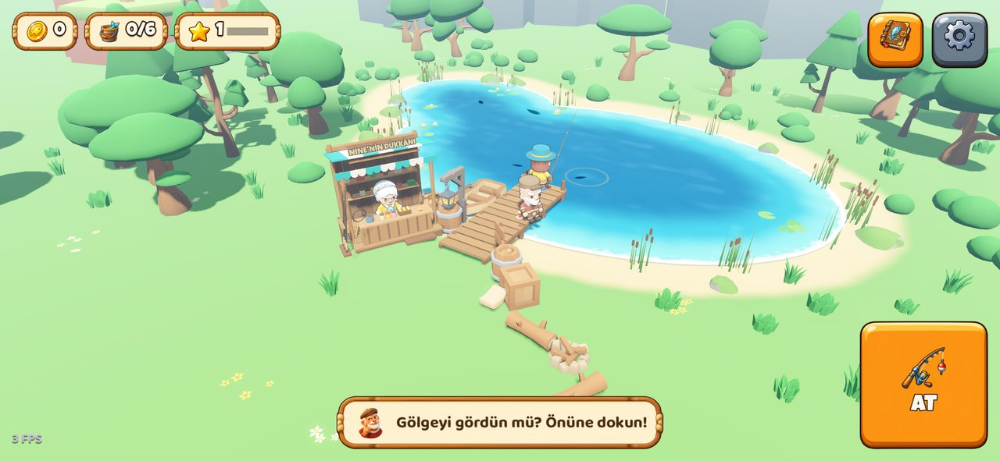
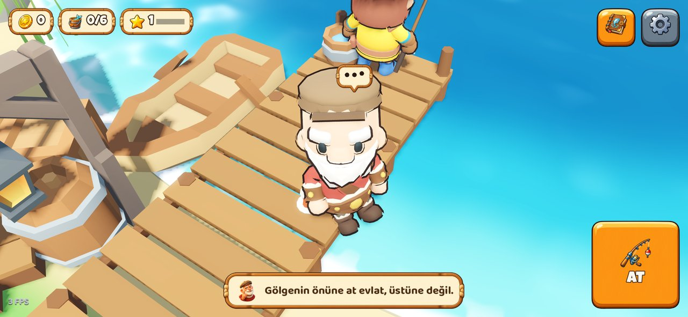
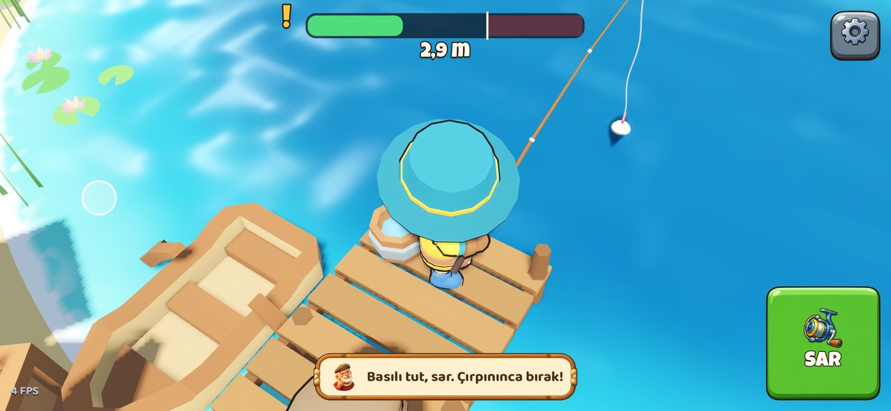
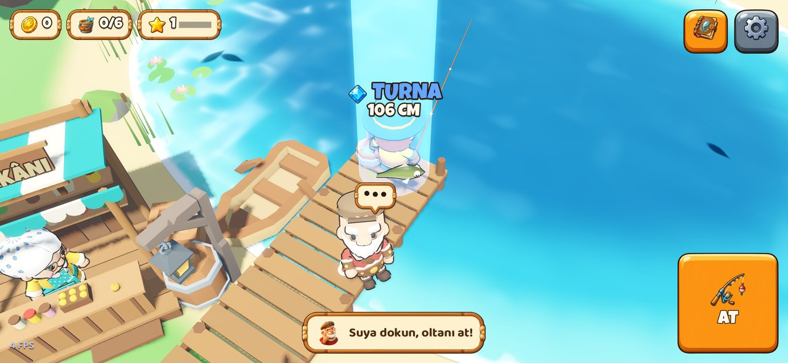
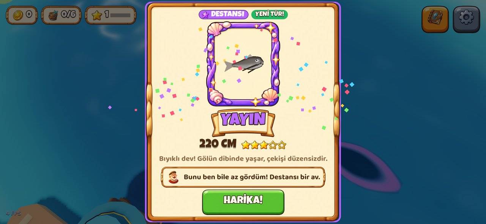
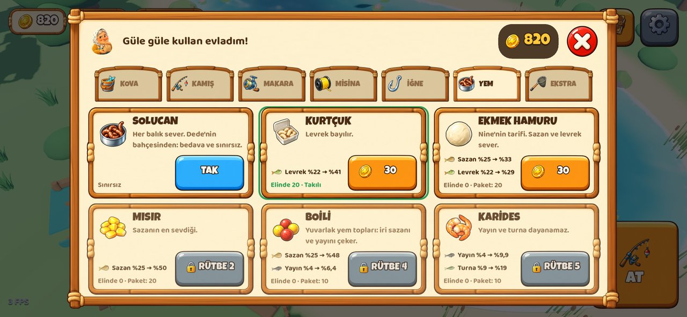
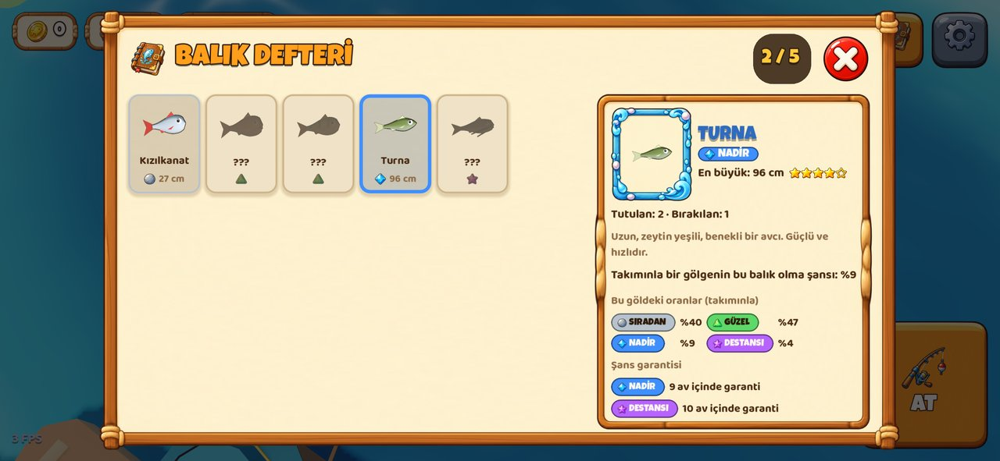
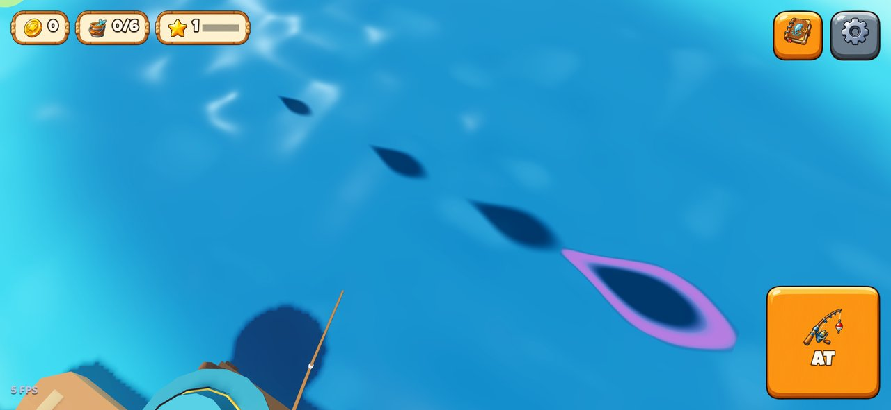
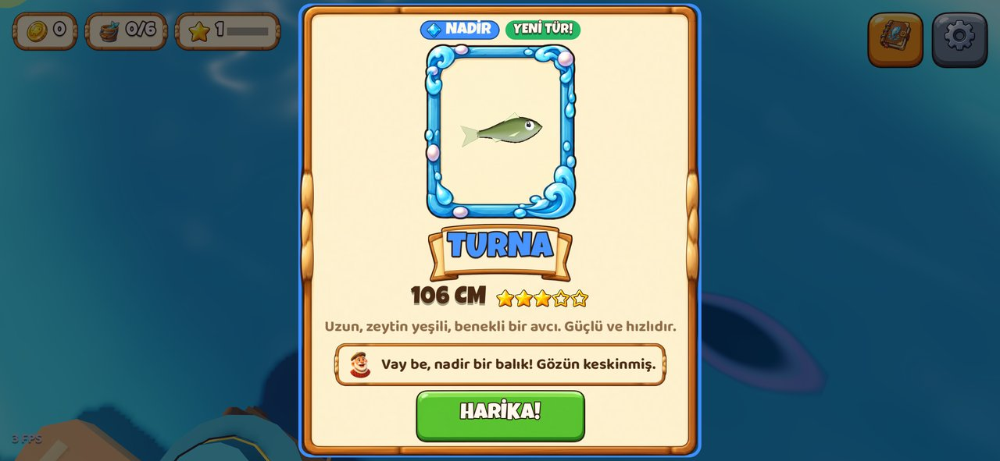

# Olta: Gölün Sırrı (EN: Lure Lake)

**"Kıyını süsle, havayı bekle: bu gece oltana ne takılacak?"** Her yaşa hitap eden, rahat bir 3D mobil balıkçılık oyunu (iOS + Android, yatay ekran). Kendi balıkçınla yazı Dede'nin göl köyünde geçiriyorsun. Suda balık gölgeleri dolaşıyor; gölgenin önüne atıyorsun, gölge yaklaşıp dürtüyor, ısırınca VUR ve çek. Ersin'in Kazı'dan sonraki oyunu; kodu Claude yazıyor.

> **Durum (Ekim 2026): v0.2.1 (H2 "Büyük Göl", Dalga 1 bitti + ara sürüm).** Nine'nin dükkânı, olta takımı (kamış, makara, misina, iğne, şamandıra, yem, kepçe, kova), para, kova ve satış, rütbe, 6 nadirlik kademesi (gölgede ipucu, simgeli rozet) ve Balık Defteri. v0.2.1'de arayüz Ersin'in görselleriyle (çerçeveler, düğmeler, rozetler, takım resimleri, Dede ve Nine'nin ifadeli portreleri, uygulama ikonu, logo), göl kenarı orman, yosunlu kayalar, nilüferler, kamp ve iskeleye bağlı sandalla. Sırada Dalga 2: büyük göl ([yol haritası](docs/yol-haritasi.md)).

| | |
|---|---|
|  |  |
|  |  |
|  |  |
|  |  |

## Nasıl oynanır

1. **At:** suya dokun. En iyisi bir gölgenin **önüne** atmak; üstüne atarsan balık korkup kaçar.
2. **Bekle:** gölge şamandırayı fark edip gelir, birkaç kez dürter (şamandıra hafifçe batar). Bu sırada dokunma.
3. **VUR:** şamandıra suya dalınca ekranın **her yerine** dokun.
4. **Çek:** parmağını basılı tut, balık gelsin. Balık çırpınınca ("!", titreşim, gıcırtı) **bırak**; gerilim kırmızıda kalırsa misina kopar.
5. Tutulan balık elde gösterilir; yeni tür, rekor ya da Nadir ve üstünde kart açılır.
6. **Kova ve dükkân:** tutulan balık kovaya girer. Nine'ye (iskelenin başındaki dükkân) dokun: kovayı sat, parayla yeni takım al. Bazı takımlar rütbe ister; rütbe balık tuttukça artar.
7. **Nadirlik:** Sıradan ●, Güzel ▲, Nadir ◆, Destansı ★, Efsanevi ✦ (oyunda Ersin'in rozetleri; şekilleri renk körü oyuncu için de ayrılır). Nadir balığın gölgesi arada pırıldar, Destansınınki mor ışıldar. Uzun süre gelmezse şans garantisi devreye girer.
8. **Balık Defteri** (sağ üst): tuttuğun türler ve rekorlar; tutmadıklarının ipuçları; takımınla gerçek oranlar ve şans garantisi sayaçları. Bütün oranlar: [balık kataloğu](docs/balik-katalogu.md).

- **Yürü:** karaya ya da iskeleye dokun. Balıkçı kıyıda durur, Dede'nin yanından kayarak geçer.
- **Dede:** ilk 3 balığa kadar ipucu verir. Ona dokununca her zaman bir öğüt söyler. İskelenin yanındaki sandala dokununca derin sulardan söz eder (sandala Dalga 2'de binilecek).
- **Ayarlar** (sağ üst): ses, titreşim, dil, **Kolay çekme** (misina kopmaz, balık kaçmaz).
- **Mac:** tıkla (yürü, at), WASD ya da oklar (yürü), Space (eylem; basılı tutunca sar).

Kısa tanıtım videosu bot ile çekilir (`video` senaryosu, bkz. [CLAUDE.md](CLAUDE.md)).

## Çalıştırma

- **Mac'te:** Godot 4.7.2'yi kur, bu klasörü aç, F5. Ya da Terminal'de: `/Applications/Godot.app/Contents/MacOS/Godot --path .`
- **iPhone'da:** Mac'teki Claude Code'a [`docs/iphone-kurulum.md`](docs/iphone-kurulum.md) dosyasını uygulat. Ücretsiz Apple hesabı yeter; uygulama 7 günde bir yeniden yüklenir, en fazla 3 uygulama yüklenebilir (Kazı da biri).
- **Testler ve botlar:** komutlar [CLAUDE.md](CLAUDE.md)'de (testler, `controls` / `first` / `hero` / `fish` / `shop` / `rarity` / `video` senaryoları, çekişme ve ekonomi raporları, balık kataloğu).

## Belgeler

- [Kısa tasarım belgesi (GDD)](docs/gdd.md): kurallar, sayılar, balıklar, Dede, görünüm, ses, gelir.
- [Yol haritası](docs/yol-haritasi.md): H1 (prototip), H2 "Büyük Göl" (5 dalga: dükkân ve nadirlik, büyük göl, teknikler, canlı dünya, yuva), H3 ve sonrası.
- [Balık kataloğu](docs/balik-katalogu.md): bütün türler, nadirlikler, yem başına oranlar ve şans garantisi (veriden üretilir).
- [Görsel istekleri](docs/gorsel-istekleri.md): Ersin'in ChatGPT ile üreteceği görseller.
- [iPhone kurulumu](docs/iphone-kurulum.md): Mac'teki Claude Code için adım adım görev.
- [Saha araştırması](docs/saha-arastirmasi.md) ve [fikirler ve karar](docs/fikirler.md).
- [Kaynaklar ve lisanslar](assets/CREDITS.md): KayKit ve Kenney modelleri (CC0), yazı tipleri, Ersin'in görselleri; sesler kodla üretildi.
- [CLAUDE.md](CLAUDE.md): Claude'un bu projede nasıl çalıştığı (komutlar, mimari, kurallar, tuzaklar).

## Nasıl çalışıyoruz

- Claude seçenekler hazırlar ve birini önerir; Ersin seçer.
- Seçilenler sıralı bir plana dökülür. Her adım ayrı commit olur; adım bitince Ersin iPhone'da dener ve geri bildirim verir.
- Görselleri Ersin ChatGPT ile üretir. 3D modeller hazır ücretsiz (CC0) paketlerden (KayKit, Kenney) gelir; sesler kodla üretilir.

Kardeş proje: [Kazı](https://github.com/ErsinAydogmuss/game).
